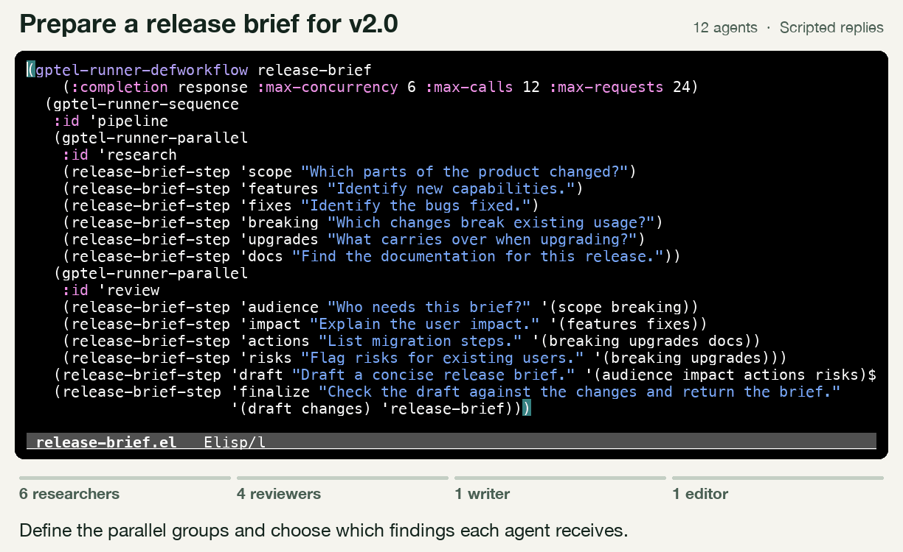

# gptel-runner

Orchestrate dozens of gptel agents around one goal in Emacs. Use Emacs Lisp
to decide which agents work in parallel, what they pass to the next stage,
and where the pipeline pauses for your input. Follow the whole run from one
dashboard.

You can save a pipeline as a background job and run it even after closing
Emacs. Recurring jobs use systemd user timers on Linux, launchd on macOS, and
Windows Task Scheduler on Windows. You can customize the scheduler executable
and its arguments on each platform.
For example, I use a weekday schedule to review our open pull requests at
3 p.m. [Set up a background job](docs/guide.md#background-jobs-and-schedules) · [Configure a scheduler](docs/guide.md#configure-a-scheduler)



In this twelve-agent pipeline, six agents research the v2.0 changes in
parallel and four review what those changes mean for users. A writer drafts
the release brief, then an editor checks it against the original changes.
The demo uses scripted replies. [Watch the 20-second video](docs/media/workflow-demo.mp4) · [Read the pipeline](examples/release-brief.el)

## Installation

Use Emacs 29.1 or newer. For live runs, install gptel 0.9.9.6 or newer and
configure your model. You can define pipeline agents with ordinary gptel
presets. The companion `gptel-agent` package is optional. [gptel setup](https://github.com/karthink/gptel#setup)

### use-package with straight.el

```elisp
(use-package gptel-runner
  :after gptel
  :straight (:host github :repo "SamuelVanie/gptel-runner" :files ("*")))
```

### Built-in use-package (Emacs 30+)

```elisp
(use-package gptel-runner
  :after gptel
  :vc (:url "https://github.com/SamuelVanie/gptel-runner.git" :rev :newest))
```

### Manual installation with load-file

Clone the repository, then add the Elisp below to your Emacs init file.

```sh
git clone https://github.com/SamuelVanie/gptel-runner.git ~/.emacs.d/gptel-runner
```

```elisp
(add-to-list 'load-path (expand-file-name "~/.emacs.d/gptel-runner"))
(load-file "~/.emacs.d/gptel-runner/gptel-runner.el")
```

**Run the demo locally.** Type `M-: (load "examples/release-brief") RET`,
then run `M-x gptel-runner-example-release-brief-demo`. The dashboard opens
and all twelve agents run without a model connection.

[Workflow guide](docs/guide.md)
